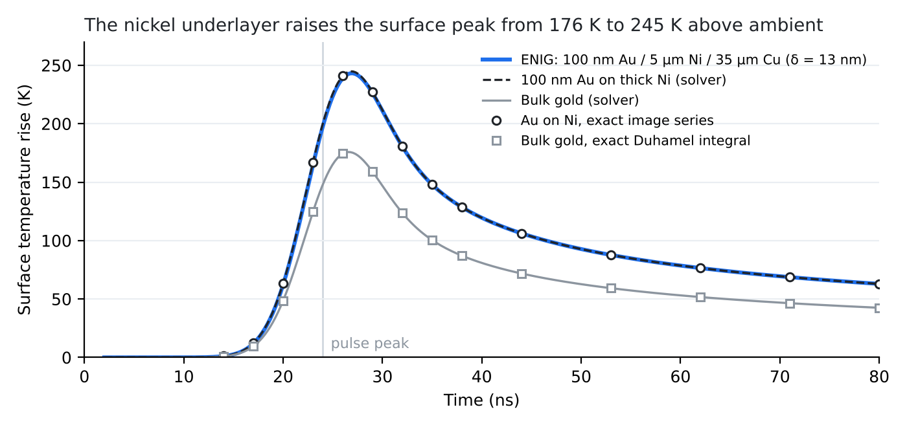

# Laser-pulse heating of an ENIG stack

How hot does a gold-plated PCB contact get under a nanosecond laser pulse, before it melts?

ENIG (electroless nickel, immersion gold) is the finish on many PCB contacts: about 100 nm of gold on a few micrometres of nickel on copper. This repository models the heat conduction stage of a laser-ablation and LIBS study on those contacts. It is written as a self-contained scientific coding problem with a Python reference solution and hidden tests whose expected values are computed independently of the solver.



The nickel under the gold takes up heat more slowly than gold would, so the ENIG surface peaks about 70 K hotter than bulk gold under the same pulse (500 J/m² absorbed, 8 ns FWHM). Lines are the solver. Markers are exact analytic values that do not use it.

## Files

| File | What it is |
| --- | --- |
| [`problem.md`](problem.md) | Problem specification: equations, units, conventions, inputs and outputs, valid regime |
| [`stack_heating.py`](stack_heating.py) | Reference solution |
| [`test_stack_heating.py`](test_stack_heating.py) | Hidden tests (pytest) |
| [`make_figure.py`](make_figure.py) | Produces the figure above |
| [`ENIG_laser_heating_work_sample.pdf`](ENIG_laser_heating_work_sample.pdf) | Full write-up, including how the tests were checked |

## Run it

```bash
pip install numpy scipy pytest matplotlib
pytest -q                 # 25 tests, about 2 s
python make_figure.py
```

```python
from stack_heating import simulate_stack_heating

au = dict(thickness=100e-9, k=317.0, rho=19300.0, cp=129.0)
ni = dict(thickness=5e-6,  k=90.9,  rho=8900.0,  cp=444.0)
cu = dict(thickness=35e-6, k=401.0, rho=8960.0,  cp=385.0)

T = simulate_stack_heating([au, ni, cu], absorbed_fluence=500.0, pulse_fwhm=8e-9,
                           t_peak=24e-9, penetration_depth=13e-9,
                           t_out=[20e-9, 27e-9, 100e-9], probe_depths=[0.0, 5.1e-6])
# T[i, j] is the temperature (K) at probe_depths[j] and t_out[i]
```

## Model

1-D heat conduction through layers with constant properties, perfect thermal contact at interfaces and adiabatic faces. The source is a Gaussian pulse in time with exponential absorption in depth. It is valid below melting and for pulses of about 1 ns or longer. Shorter pulses need a two-temperature model. The full statement is in [`problem.md`](problem.md).

The solver uses vertex-centred finite volumes on a graded mesh, with every interface on a node. The source is integrated exactly per cell, so energy is conserved to the integrator's tolerance. Time stepping is implicit BDF because the cells range from sub-nanometre to sub-micrometre.

## How the expected values are obtained

- **Thick single-material layers:** the Duhamel integral for a semi-infinite solid under a surface flux, evaluated with `scipy.integrate.quad`.
- **Gold film on nickel:** the exact image-series solution, with reflection coefficient Γ = (e_Au − e_Ni)/(e_Au + e_Ni), where e = √(kρc).
- **Energy balance:** deposited energy in closed form.
- **Late-time limit:** uniform temperature set by the total heat capacity.
- **Linearity:** the response scales with fluence and does not depend on T0.

The reference solution sits within 0.2% of the analytic values. The tolerance is 1% of the peak rise, which leaves room for other valid methods.

## Checking the tests

I planted 11 realistic bugs in the solver, one at a time, to see which tests catch them. The first round showed that no quantitative test measured heat flow between two *different* metals, so I added the gold-on-nickel image-series test. Every substantive bug now fails at least one test. Three harmless numerical variations still pass, and should.

Making the figure also exposed a real bug: an output time landing exactly on the solver's internal split point crashed it. A test now covers that case.

Alvin Kigondu
